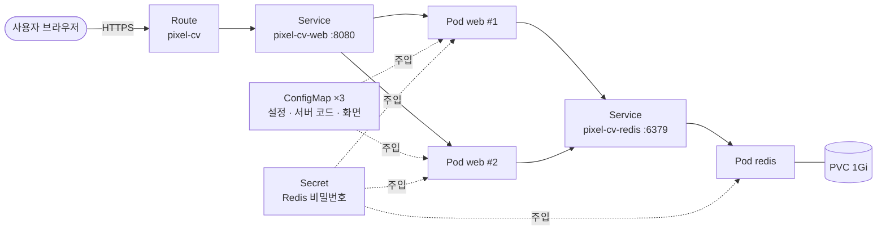
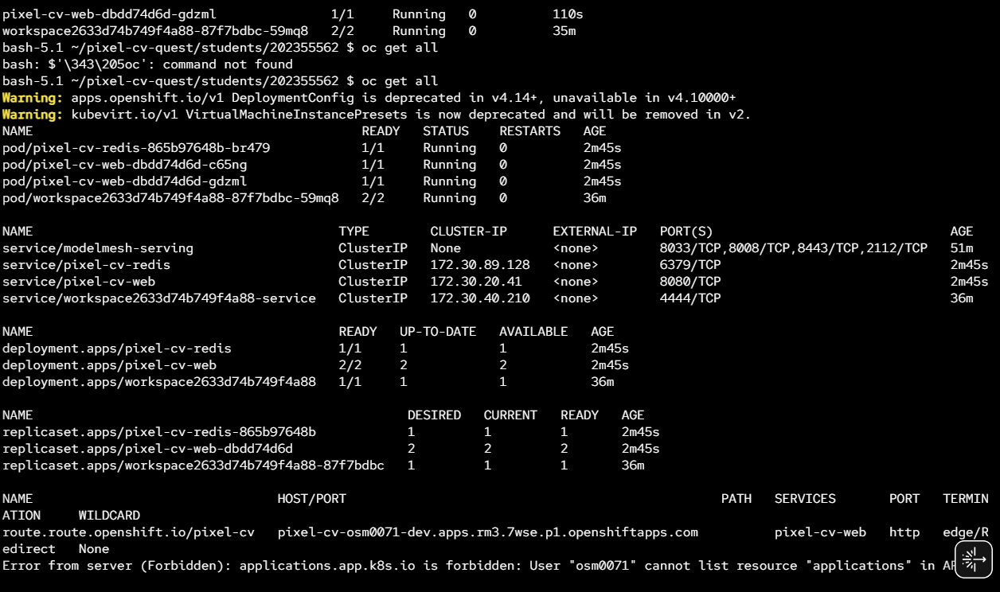
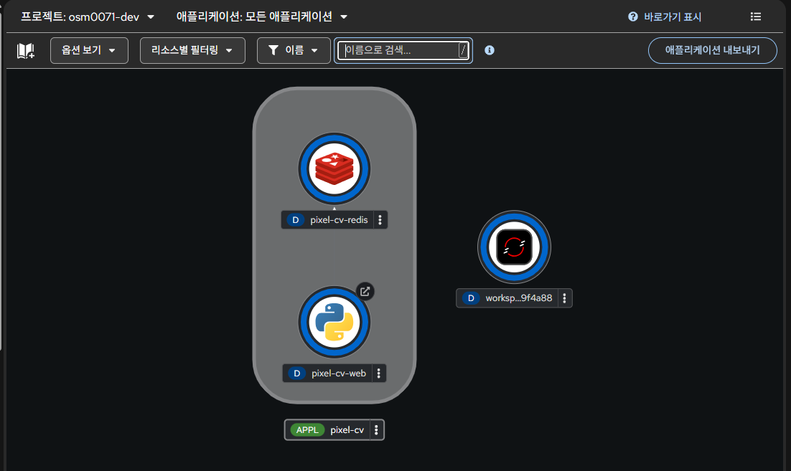
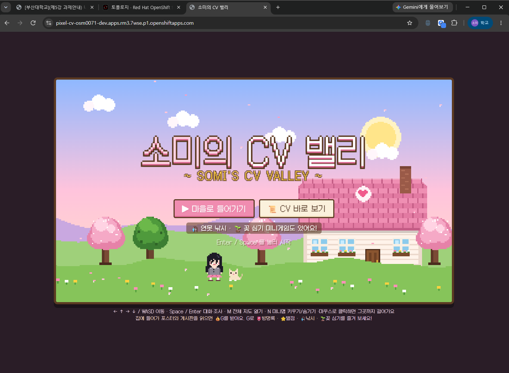
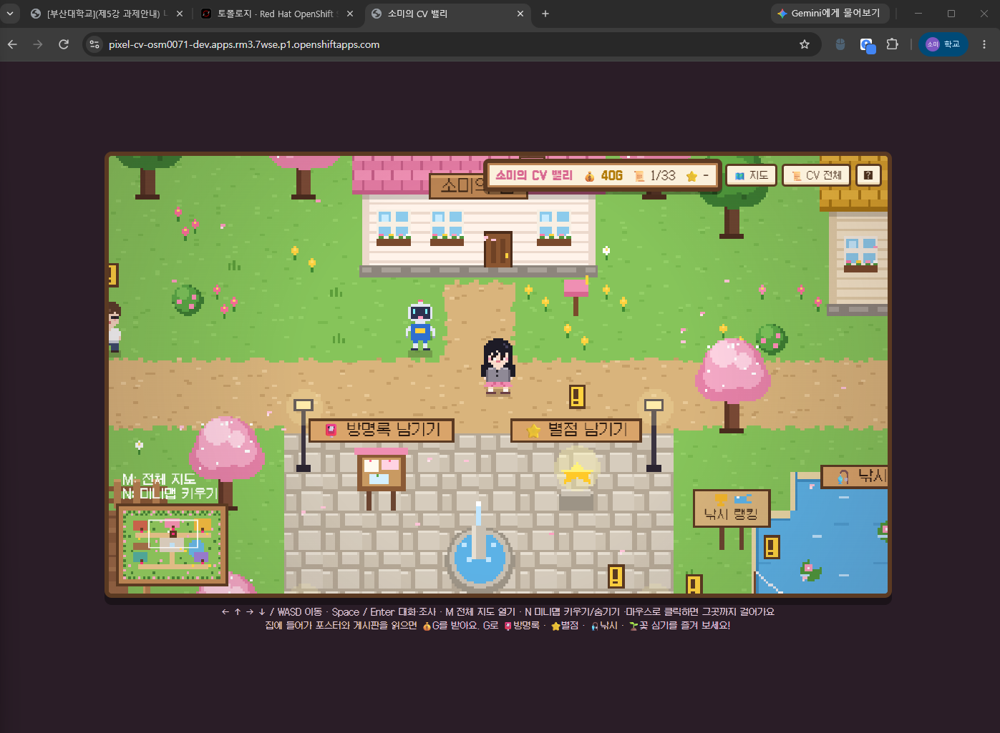

# 🌸 소미의 CV 밸리 — 걸어 다니며 읽는 픽셀 이력서

> 픽셀 마을을 돌아다니며 이력을 읽고, 모은 G(골드)로 방명록·별점을 남기는 **웹 + DB 2-tier 컨테이너 서비스**

| 항목 | 내용 |
|---|---|
| 이름 / 학번 | 옥소미 / 202355562 |
| 난이도 | 심화 (웹 + DB 2-tier, PVC, 다중 Deployment) |
| 사용 Object | Deployment ×2, Service ×2, Route, ConfigMap ×3, Secret, PVC, Liveness/Readiness Probe, resources |

---

## 1. 컨테이너 소개

**소미의 CV 밸리**는 이력서를 픽셀 게임 마을로 만든 웹 서비스입니다.

- **한 줄 설명**: 집에 들어가 전시물을 읽으면 G가 쌓이고, G로 방명록·별점을 남기는 게임형 CV
- **이 주제를 고른 이유**: 과제 예시의 "자기소개 웹페이지"와 "방명록 서비스"를 합쳐서, 포인트·방명록처럼 **상태가 있는 기능**을 통해 DB 컨테이너와 PVC가 왜 필요한지 직접 확인해 보고 싶었습니다.

**주요 기능**

| 기능 | 설명 |
|---|---|
| 마을 탐험 | 방향키/WASD 또는 클릭으로 이동, 미니맵과 전체 지도 |
| 집 5채 | 소미의 집, DTPLab 연구실, 캡스톤 홀, 프로젝트 공방, 대외활동 센터 |
| 전시물 문서 | 포스터·게시판 등을 조사하면 이력 문서가 열림 (포스터 이미지, 발표 영상 포함) |
| G(골드) | 전시물을 처음 읽거나 주민과 처음 대화하면 +10G |
| 방명록 · 별점 | 광장에서 G를 써서 한 줄 남기기(30G), 1~5점 별점(20G) |
| 미니게임 | 연못 낚시(물고기 도감·랭킹), 방문자 꽃밭(내 이름의 꽃 심기) |

---

## 2. 아키텍처



**요청 흐름**: 사용자 → Route → Service `pixel-cv-web` → web Pod(2개 중 하나) → Service `pixel-cv-redis` → Redis Pod → PVC

### 사용한 Object와 역할

| Object | 이름 | 역할 |
|---|---|---|
| Deployment | `pixel-cv-web` | 웹·API 서버 Pod 2개 (RollingUpdate) |
| Deployment | `pixel-cv-redis` | Redis Pod 1개 |
| Service | `pixel-cv-web`, `pixel-cv-redis` | Pod들의 고정 접근 주소 (8080 / 6379) |
| Route | `pixel-cv` | 외부 HTTPS 주소 공개 |
| ConfigMap | `pixel-cv-config` | Redis 주소, G 규칙 등 설정 → 환경변수 |
| ConfigMap | `pixel-cv-code`, `pixel-cv-static` | 서버 코드와 게임 화면 파일 → 파일 마운트 |
| Secret | `pixel-cv-redis` | Redis 비밀번호 (web과 redis가 같이 참조) |
| PVC | `pixel-cv-redis-data` | Redis 데이터 저장 (Pod가 재시작돼도 유지) |
| Probe | — | web: `/alive`, `/health`(Redis 연결 확인) · redis: `redis-cli ping` |
| resources | — | 모든 컨테이너에 requests/limits 지정 |

> 이미지를 직접 빌드하지 않고, 공개 Python 이미지에 내 코드를 ConfigMap으로 넣어 실행합니다.
> 용량이 큰 포스터·영상은 Git 저장소의 `media/`에 두고 CDN(jsDelivr)으로 불러옵니다.

---

## 3. 사용 이미지

| 컨테이너 | 이미지 | 포트 | 선택 이유 |
|---|---|---|---|
| web | `registry.access.redhat.com/ubi9/python-311:9.8` | 8080 | Red Hat 공식 이미지, OpenShift의 비루트 실행 지원 |
| redis | `quay.io/sclorg/redis-7-c9s:20250108` | 6379 | 공개 Redis 7 이미지, 비루트 실행과 비밀번호 환경변수 지원 |

---

## 4. 배포 방법

Sandbox 웹 콘솔의 Web Terminal(`>_`)에서 실행했습니다.

```bash
git clone https://github.com/oxomi/pixel-cv-quest.git
cd pixel-cv-quest/students/202355562

oc apply -f k8s/          # 배포
oc get pods               # web 2개, redis 1개가 1/1 Running 인지 확인
oc get route pixel-cv     # 접속 주소 확인
```

**확인 방법**: Route 주소(`https://<route-host>/`)로 접속하면 "소미의 CV 밸리" 시작 화면이 나옵니다. `/health`는 `{"status": "ok", "storage": "redis"}`를 돌려줍니다.

**재현성 확인**: `oc delete -f k8s/` 후 `oc apply -f k8s/`만으로 다시 배포됩니다.

### 폴더 구조

```
202355562/
├── README.md
├── k8s/                ← 채점 대상 YAML
├── app/                ← 원본 소스 (server.py, index.html, game.js, content.js)
├── build_configmap.py  ← app/ 소스를 k8s/configmap.yaml로 묶는 스크립트
├── media/              ← 포스터·영상 (CDN으로 제공)
└── images/             ← 배포 결과 캡처
```

---

## 5. 배포 결과

접속 주소: https://pixel-cv-osm0071-dev.apps.rm3.7wse.p1.openshiftapps.com

### `oc get all`

Pod 3개(web 2, redis 1)가 모두 `1/1 Running`이고, Service 2개와 Route가 만들어졌습니다.



### Topology

web과 redis가 하나의 애플리케이션으로 묶여 있고, web → redis 연결이 표시됩니다.



### 브라우저 접속 화면





---

## 6. 어려웠던 점

| 문제 | 해결 |
|---|---|
| 이미지를 빌드하지 않고 내 코드를 실행해야 함 | 코드를 ConfigMap으로 만들어 공개 Python 이미지에 마운트 |
| 포스터·영상이 ConfigMap 크기 제한을 넘음 | Git 저장소에 두고 CDN으로 불러오도록 분리 |
| 배포 직후 web Pod가 `0/1`로 Ready가 안 됨 | Redis가 아직 뜨는 중이라 Readiness Probe가 실패한 것. Redis가 뜬 뒤 자동으로 `1/1`이 됨 |
| 코드를 바꿔 `oc apply`했는데 화면이 그대로 | `oc rollout restart deployment/pixel-cv-web`으로 Pod를 새로 띄워 반영 |

---

## 7. AI·참고자료 활용 내역

| 도구 / 자료 | 용도 |
|---|---|
| Claude (Claude Code) | 게임·서버 코드, YAML 초안 작성 |
| 수업 자료 (OpenShift 실습, 워크샵 매뉴얼) | Probe, resources, ConfigMap·Secret·PVC 구성 참고 |
| [sclorg/redis-container](https://github.com/sclorg/redis-container) | Redis 이미지 사용법 확인 |
| [Galmuri](https://github.com/quiple/galmuri) | 픽셀 한글 폰트 |

AI가 작성한 YAML은 본인 Developer Sandbox에 직접 배포하여 동작을 확인했습니다.
