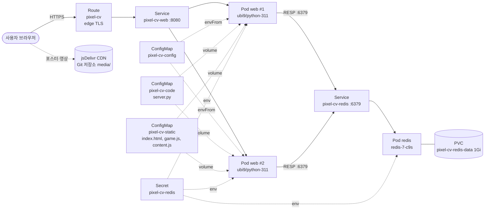

# 🌸 소미의 CV 밸리 — 걸어 다니며 읽는 픽셀 이력서

> 픽셀 마을을 걸어 다니며 집 안의 포스터·게시판·TV로 이력을 탐험하고, 모은 G(골드)로 방명록과 별점을 남기는 **웹 + DB 2-tier 컨테이너 서비스**

| 항목 | 내용 |
|---|---|
| 이름 / 학번 | 옥소미 / 202355562 |
| 과목 | 지능형IoT플랫폼 — 나만의 컨테이너 만들기 |
| 난이도 | 심화 (웹 + DB 2-tier, PVC, 다중 Deployment) |
| 사용 Object | Deployment ×2, Service ×2, Route, ConfigMap ×3, Secret, PVC, Liveness/Readiness Probe, Resource requests/limits |

---

## 1. 컨테이너 소개

**소미의 CV 밸리**는 종이 이력서 대신 **아늑한 픽셀 농장 마을**에서 제 이력을 소개하는 웹 서비스입니다.

- **한 줄 설명**: 집에 들어가 전시물을 읽으면 G가 쌓이고, G로 방명록·별점을 남기는 게임형 CV
- **이 주제를 고른 이유**
  - 과제 예시의 "자기소개 웹페이지"와 "방명록 서비스"를 하나로 합쳐서, 수업에서 배운 Object(ConfigMap, Secret, PVC, Probe)를 모두 **의미 있게** 써 보고 싶었습니다.
  - 포인트 적립·차감처럼 **상태가 있는 기능**이 있어야 DB 컨테이너와 영구 볼륨이 왜 필요한지 직접 확인할 수 있습니다.
- **주요 기능**

| 기능 | 설명 |
|---|---|
| 🌸 타이틀 화면 | 벚꽃잎이 흩날리는 픽셀 풍경 위 "소미의 CV 밸리" 로고 |
| 🕹️ 마을 탐험 | 40×28 타일 마을을 카메라가 따라다님. 방향키/WASD, **클릭하면 BFS 경로 탐색으로 자동 이동**, 모바일 패드 |
| 🏠 집 5채 실내 | 소미의 집 · DTPLab 연구실 · 🏆캡스톤 홀 · 프로젝트 공방 · 대외활동 센터 — 문으로 들어가고 매트로 나옴 |
| 📜 전시물 문서 | 포스터·게시판·TV·책장 등 21개 전시물을 조사하면 **마크다운 문서**가 열림 (졸업과제 포스터 이미지, 발표 영상 포함) |
| 💬 주민 | PNU-bot, 연구실 선배, 졸과 팀원, 해커톤 MC, 위성 연구원, 고양이 모찌 (초상화가 있는 대화창) |
| 💰 G(골드) | 전시물을 처음 읽거나 주민과 처음 대화하면 +10G (장소당 1회, 서버에서 검증) |
| 📮 방명록 | 광장 게시판에서 30G로 한 줄 남기기 (Redis에 저장, 최신 50개 표시) |
| ⭐ 별점 | 광장 별 동상에서 20G로 1~5점, 1인 1회 (평균은 HUD에 표시) |
| 📜 CV 전체 | 게임 없이 모든 문서를 한 번에 보기 |

> 주인공은 제 증명사진을 참고해 직접 그린 16×24 픽셀 캐릭터이고, 모든 그래픽은 외부 에셋 없이 코드로 그렸습니다.
> G 규칙(10G / 30G / 20G)과 미디어 주소는 코드가 아니라 **ConfigMap**에 있어서, 코드를 건드리지 않고 값만 바꿔 운영할 수 있습니다.

---

## 2. 아키텍처



> 포스터(300KB)와 발표 영상(19MB)은 ConfigMap 크기 제한(1MiB, `oc apply` 주석 256KB)을 넘기 때문에 Git 저장소의 `media/`에 두고
> 브라우저가 jsDelivr CDN에서 직접 받아옵니다. 주소는 ConfigMap의 `MEDIA_BASE`, `VIDEO_URL`로 주입됩니다.

**요청 흐름**: 사용자 → **Route**(외부 HTTPS 주소) → **Service** `pixel-cv-web` → label `app=pixel-cv, component=web`이 붙은 **Pod 2개** 중 하나 → Pod가 **Service** `pixel-cv-redis`로 Redis에 접속 → Redis는 **PVC**에 데이터 저장

### 사용한 Object와 역할

| 파일 | Object | 이름 | 역할 |
|---|---|---|---|
| `deployment.yaml` | Deployment | `pixel-cv-web` | 웹+API 서버 Pod 2개 유지, RollingUpdate(maxUnavailable 0)로 무중단 교체 |
| `deployment.yaml` | Deployment | `pixel-cv-redis` | Redis Pod 1개, RWO 볼륨이라 `Recreate` 전략 |
| `service.yaml` | Service | `pixel-cv-web` | 웹 Pod들의 고정 접근점 (8080) |
| `service.yaml` | Service | `pixel-cv-redis` | 클러스터 내부 전용 DB 접근점 (6379) |
| `route.yaml` | Route | `pixel-cv` | 외부 HTTPS URL 공개, HTTP는 HTTPS로 리다이렉트 |
| `configmap.yaml` | ConfigMap | `pixel-cv-config` | Redis 주소, 포트, G 규칙, 미디어 주소 → **환경변수**로 주입 |
| `configmap.yaml` | ConfigMap | `pixel-cv-code` | API 서버 코드 `server.py` → **파일 마운트** |
| `configmap.yaml` | ConfigMap | `pixel-cv-static` | 게임 화면 `index.html`, `game.js`, 전시물 문서 `content.js` → **파일 마운트** |
| `secret.yaml` | Secret | `pixel-cv-redis` | Redis 비밀번호, 웹과 Redis가 같은 값을 참조 |
| `pvc.yaml` | PersistentVolumeClaim | `pixel-cv-redis-data` | Redis 데이터 영구 저장 (Pod 재시작/재배포 후에도 방명록 유지) |
| (deployment 안) | Liveness/Readiness Probe | — | web: `/alive`(프로세스 생존), `/health`(Redis까지 연결돼야 Ready) · redis: `redis-cli ping`, TCP 6379 |
| (deployment 안) | resources | — | 모든 컨테이너에 requests/limits 지정 (Sandbox 할당량 고려) |

### 설계 포인트

- **이미지 빌드 없이 "나만의 서비스" 만들기**: 공개 Python 이미지에 코드를 ConfigMap으로 주입했습니다. 서버는 **Python 표준 라이브러리만** 사용해서 `pip install`이 필요 없고, Redis 접속도 RESP 프로토콜을 직접 구현했습니다. 그래서 Pod가 외부 패키지 저장소에 의존하지 않습니다.
- **Readiness는 DB까지 확인**: `/health`는 Redis `PING`이 성공해야 200을 줍니다. Redis가 아직 안 떴으면 웹 Pod는 Ready가 되지 않아 Route가 트래픽을 보내지 않습니다.
- **G 조작 방지(서버 검증)**: 방문 보상은 서버가 아는 장소 ID만 받고 Redis Set(`SADD`)으로 장소당 1회만 지급하며, 차감은 **Lua 스크립트로 원자적으로** 처리해서 동시에 여러 번 눌러도 포인트가 음수가 되지 않습니다.
- **web은 Stateless, 상태는 Redis에**: 그래서 web을 2개로 늘려도 어느 Pod로 가든 같은 포인트가 보입니다.
- **AOF(`--appendonly yes`)**: 쓰기마다 디스크에 기록해서 Redis Pod가 재시작돼도 데이터가 남습니다.

---

## 3. 사용 이미지

| 컨테이너 | 이미지 | 포트 | 선택 이유 |
|---|---|---|---|
| web | `registry.access.redhat.com/ubi9/python-311:9.8` | 8080 | Red Hat UBI 이미지라 OpenShift의 **임의 UID(비루트) 실행**을 지원하고, Docker Hub 다운로드 제한이 없음. 1024 이상 포트(8080) 사용 |
| redis | `quay.io/sclorg/redis-7-c9s:20250108` | 6379 | Red Hat Software Collections의 Redis 7 (워크샵에서 쓴 `rhel9/redis-7`의 공개 CentOS Stream 빌드). 비루트 실행, `REDIS_PASSWORD` 환경변수 지원, quay.io 공개 이미지 |

> 재현성을 위해 `latest` 대신 **고정 태그**를 사용했습니다.

---

## 4. 배포 방법

```bash
# 0) Developer Sandbox 웹 콘솔 → 우측 상단 계정 → Copy login command 로 로그인
oc login --token=<토큰> --server=<서버>

# 1) 배포 (k8s 폴더 안의 YAML 전부 적용)
oc apply -f k8s/

# 2) Pod 2종(web 2개, redis 1개)이 Running / READY 1/1 이 될 때까지 확인
oc get pods -w

# 3) 접속 주소 확인
oc get route pixel-cv -o jsonpath='https://{.spec.host}{"\n"}'
```

**확인 방법**

| 경로 | 예상 결과 |
|---|---|
| `https://<route-host>/` | "소미의 CV 밸리" 타이틀 화면 → 마을로 들어가기 |
| `https://<route-host>/health` | `{"status": "ok", "storage": "redis"}` |
| `https://<route-host>/api/guestbook` | `{"entries": [...]}` |

**재현성 검증 (채점 방식과 동일)**

```bash
oc delete -f k8s/
oc apply -f k8s/
```

**코드를 수정했을 때** (`app/` 폴더의 원본을 고친 경우)

```bash
python build_configmap.py                    # app/ → k8s/configmap.yaml 재생성
oc apply -f k8s/
oc rollout restart deployment/pixel-cv-web   # ConfigMap 변경은 Pod 재시작 후 반영
```

### 폴더 구조

```
202355562/
├── README.md
├── build_configmap.py      ← app/ 소스를 configmap.yaml로 묶는 스크립트
├── app/                    ← 사람이 읽고 고치는 원본 소스 (배포에는 configmap.yaml이 쓰임)
│   ├── server.py
│   └── static/ (index.html, game.js, content.js)
├── media/                  ← 졸업과제 포스터·발표 영상 (jsDelivr CDN으로 서빙)
├── k8s/                    ← 채점 대상 YAML
│   ├── configmap.yaml  deployment.yaml  service.yaml
│   ├── route.yaml      secret.yaml      pvc.yaml
└── images/                 ← 배포 결과 캡처
```

---

## 5. 배포 결과

> TODO: 캡처 추가

- `oc get all` 출력

  

- Topology 화면 (web → redis 연결 화살표)

  

- 브라우저 접속 화면

  

- 방명록 / 별점 동작

  

- 재배포 후 데이터 유지 확인 (`oc delete pod -l component=redis` 후에도 방명록 유지)

---

## 6. 어려웠던 점

| 문제 | 원인 | 해결 |
|---|---|---|
| 이미지를 빌드하지 않고 내 코드를 실행해야 함 | 과제 조건상 Podman 빌드 없이 공개 이미지만 사용 | 코드를 ConfigMap으로 만들어 볼륨 마운트, 표준 라이브러리만 사용해 `pip install` 제거 |
| Redis 드라이버(redis-py)를 설치할 수 없음 | 위와 같은 이유 | RESP 프로토콜(명령 배열 전송, `+ - : $ *` 응답 파싱)을 직접 구현 |
| ConfigMap 마운트 디렉터리에 `..data` 같은 숨은 심볼릭 링크가 생김 | ConfigMap 볼륨의 원자적 업데이트 방식 | 정적 파일은 허용된 확장자의 최상위 파일만 서빙하도록 제한 |
| `oc apply` 시 큰 ConfigMap 주의 | client-side apply는 오브젝트 전체를 annotation에 저장(256KB 제한) | `build_configmap.py`에서 오브젝트별 크기 검사 (가장 큰 것 약 110KB) |
| 포스터·영상을 넣을 곳이 없음 | 이미지 빌드 없음 + ConfigMap 크기 제한 | 영상을 ffmpeg로 720p 압축(64MB → 19MB)해 Git에 두고 jsDelivr CDN으로 서빙, 주소는 ConfigMap으로 주입 |

<!-- TODO: Sandbox에 직접 배포하면서 겪은 오류가 있으면 여기에 추가 -->

---

## 7. AI·참고자료 활용 내역

| 도구 / 자료 | 용도 |
|---|---|
| Claude (Claude Code) | 게임 코드(Canvas 픽셀 아트, 마을·실내, 마크다운 뷰어), Python API 서버, YAML 초안 작성, ConfigMap 생성 스크립트 작성, 로컬 테스트 |
| [Galmuri](https://github.com/quiple/galmuri) (SIL OFL) | 픽셀 한글 폰트 (jsDelivr CDN) |
| 수업 자료 (OpenShift 실습 1·2, 핸즈온 워크샵 매뉴얼) | Probe 경로(`/alive`, `/health`), resources, ConfigMap 주입 방식, Secret·PVC 구성 참고 |
| [sclorg/redis-container](https://github.com/sclorg/redis-container) | Redis 이미지의 `REDIS_PASSWORD`, 데이터 경로(`/var/lib/redis/data`), `run-redis` 인자 전달 방식 확인 |
| [Redis RESP 프로토콜 문서](https://redis.io/docs/latest/develop/reference/protocol-spec/) | 최소 Redis 클라이언트 구현 |

AI가 작성한 YAML은 본인 Developer Sandbox에 직접 배포하여 동작을 확인했습니다. <!-- TODO: 배포 확인 후 유지 -->
